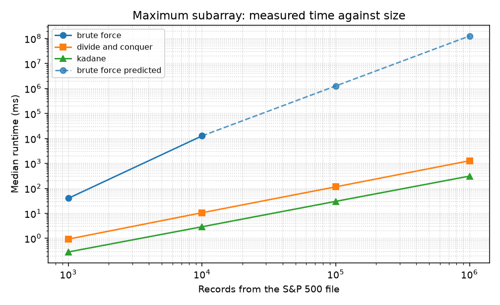
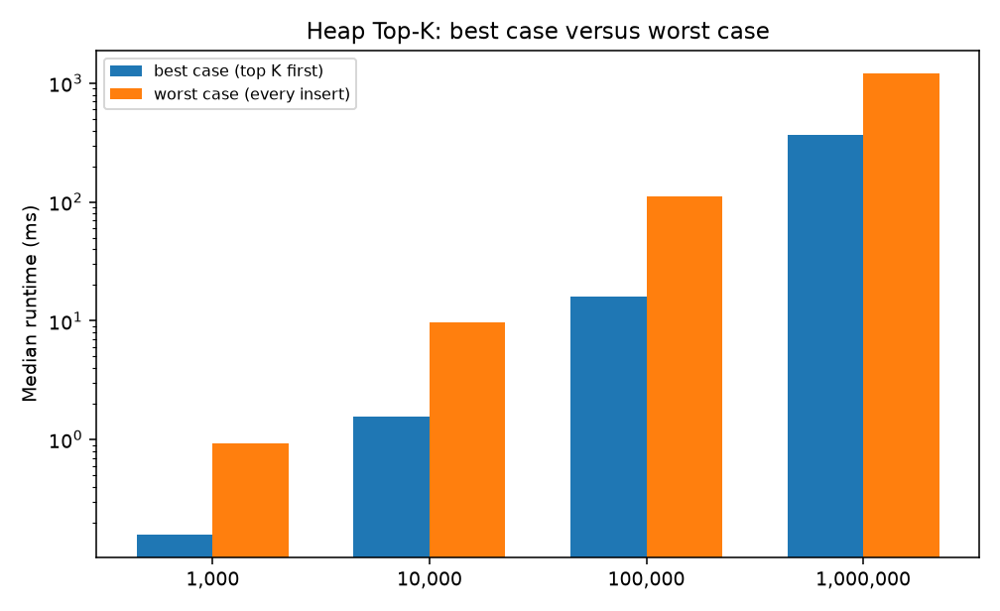

# Historical Stock Market Algorithm Analyzer

CPS 3440 group project at Kean University: comparing maximum-subarray and Top-K algorithms on real S&P 500 data.

Team: Aashish Joshi, Aron Dardouri, and Bhartendra Kumar Mandal.

## The problem

Given the daily closing prices of S&P 500 stocks, we ask two questions and answer each with several algorithms whose costs are far apart:

1. **Best single trade:** on which day would you have bought and on which later day sold to make the most money per share? (the *maximum-subarray* problem)
2. **Top movers:** which K stocks had the largest buy-and-hold return? (the *Top-K* problem)

This is analysis of algorithms, not price prediction. Every timing in this repository was measured on the real data file.

## Dataset

- **Name and source:** [S&P 500 Historical Data, Kaggle, jacksaleeby](https://www.kaggle.com/datasets/jacksaleeby/s-and-p500-historical-data), file `SP500_Historical_Data.csv`.
- **Size:** 2,703,531 rows, 472 tickers, 2000-01-03 through 2026-02-20 (about 143 MB).
- **Fields used:** `Ticker`, `Date`, `Adj Close`. The other columns (`Open`, `High`, `Low`, `Close`, `Volume`) are read by the file format but not used.
- **Preprocessing:** rows with a blank ticker, date, or price are skipped; each price becomes an integer number of micro-dollars so sums are exact; prices are sorted by date per ticker; the daily change is the difference between consecutive closes.
- **Missing data and limitations:** the file contains only companies that are in the index today (survivorship bias), uses adjusted closes only, and ignores trading costs. A "best trade" found with hindsight is not something a real investor could have planned.
- **License:** check the license on the dataset's Kaggle page. The CSV is **not stored in this repository**; see [`data/README.md`](data/README.md) for how to download it.

## Technologies

Python 3.12 and its standard library for all algorithms (`unittest` for tests); matplotlib for the figures; qrcode and pillow for the QR code; python-pptx for the slides; Google Colab for the research notebook; GitHub Pages for the website.

## Install

```bash
git clone https://github.com/aashish000000/CPS3440-Algorithm-Analyze.git
cd CPS3440-Algorithm-Analyze
python3 -m pip install -r requirements.txt
```

Download the CSV from Kaggle and save it as `data/SP500_Historical_Data.csv`.

## Run the analyzer

```bash
python3 -m analyzer --ticker AAPL --k 10
python3 -m analyzer --ticker AAPL --k 10 --html docs/results.html
```

Example output (timings left out because they vary by machine):

```text
Source: data/SP500_Historical_Data.csv
Tickers compared: 472
Best buy/sell window for AAPL (6573 closes, 2000-01-03 through 2026-02-20)
  brute_force          O(n^2)   buy 2002-10-08 at $0.20, sell 2025-12-02 at $285.92, profit $285.72 per share (142,860.00%)
  divide_and_conquer   O(n log n)   buy 2002-10-08 at $0.20, sell 2025-12-02 at $285.92, profit $285.72 per share (142,860.00%)
  kadane               O(n)   buy 2002-10-08 at $0.20, sell 2025-12-02 at $285.92, profit $285.72 per share (142,860.00%)
  Maximum-subarray algorithms agree.

Top 10 movers by buy-and-hold return
  full_sort            O(n log n)
  binary_heap          O(n log k)
  quickselect          O(n) average
  Top-K algorithms agree.
   1. NVDA     210,811.11%
   2. MNST     209,300.00%
   3. AXON     94,228.26%
   4. DECK     79,026.66%
   5. TPL      75,639.39%
   6. NFLX     65,458.33%
   7. ODFL     42,748.93%
   8. TSCO     33,000.00%
   9. AAPL     31,397.61%
  10. AVGO     29,079.82%
```

Options: `--since` and `--until` take `YYYY-MM-DD`. `--fetch PATH` downloads a fresh Yahoo Finance history (not used for the paper or the benchmark).

## Run it in Google Colab

[](https://colab.research.google.com/github/aashish000000/CPS3440-Algorithm-Analyze/blob/main/notebooks/Stock_Algorithm_Analyzer.ipynb)

The notebook clones this repository, downloads the data, and runs the full study with charts.

## Tests

```bash
python3 -m unittest discover -s tests
```

22 tests, including the textbook (CLRS) maximum-subarray example and checks that all algorithms agree.

## Project structure

| Path | What it is |
| --- | --- |
| `analyzer/` | The algorithms, the data loader, the benchmark runner, and the command-line tool |
| `tests/` | Unit tests |
| `benchmarks/results.json` | Five-trial medians and operation counts |
| `docs/` | The GitHub Pages website, pseudocode, and figures |
| `notebooks/` | The Google Colab research notebook |
| `data/` | Dataset instructions (the CSV is not committed) |
| `CONTRIBUTIONS.md` | Who is responsible for what |

## Algorithms implemented

Daily adjusted-close changes are integers (micro-dollars). The sum of a contiguous block of changes is the profit per share of one buy and one later sell. When every window loses money the best choice is to skip the trade. Ties keep the earliest window.

### Best buy and sell (maximum subarray), in `analyzer/max_subarray.py`

| Algorithm | Idea |
| --- | --- |
| Brute force | Build prefix sums, then score every start and end with one subtraction. |
| Divide and conquer | Split in half. The best window is entirely left, entirely right, or crosses the midpoint (found with two linear scans). |
| Kadane | One left-to-right pass. Throw away a negative running sum, because extending it cannot help. |

### Top movers (Top-K, k = 10), in `analyzer/top_k.py`

| Algorithm | Idea |
| --- | --- |
| Full sort | Our own merge sort of every ticker, then take the first K. |
| Binary heap of size K | Keep the K best so far in a heap whose root is the weakest survivor. |
| Quickselect | Partition around a pivot until the best K are in front. |

The merge sort and the heap are written by us (no `sorted()` or `heapq` inside the algorithms; those appear only in the tests, as independent checkers).

**Pseudocode, correctness arguments, and best, average, and worst-case bounds:** [`docs/algorithms.md`](docs/algorithms.md).

## Complexity summary

| Maximum-subarray algorithm | Best | Average | Worst | Extra space |
| --- | --- | --- | --- | --- |
| Brute force | Θ(n²) | Θ(n²) | Θ(n²) | Θ(n) |
| Divide and conquer | Θ(n log n) | Θ(n log n) | Θ(n log n) | Θ(log n) |
| Kadane | Θ(n) | Θ(n) | Θ(n) | Θ(1) |

| Top-K algorithm | Best | Average | Worst | Extra space |
| --- | --- | --- | --- | --- |
| Full sort (own merge sort) | Θ(n log n) | Θ(n log n) | Θ(n log n) | Θ(n) |
| Binary heap of size K | Θ(n + k log k) | Θ(n log k) bound | Θ(n log k) | Θ(k) |
| Quickselect | Θ(n) | Θ(n) | Θ(n²) | Θ(log n) |

## Experimental method

Prefixes of 1,000, 10,000, 100,000, and 1,000,000 records of the real data, five trials each, median reported. A second metric counts pair iterations, element reads, or comparisons exactly. Brute force is **executed only through 10,000 records**; its 100,000- and 1,000,000-record times are an n² projection from the 10,000-record median and are labelled *projected*, not measured. Reproduce with:

```bash
python3 -m analyzer.benchmark --data data/SP500_Historical_Data.csv --out benchmarks/results.json --figures docs/assets
python3 docs/render.py
```

## Major results

Measured on one laptop. Absolute times vary by machine; the shapes of the curves do not.

| Question | Result |
| --- | --- |
| Brute force at 10,000 records | 12.74 s (measured) |
| Brute force at 100,000 and 1,000,000 records | 21.2 minutes and 35.4 hours (**projected**, not measured) |
| Kadane at 1,000,000 records | 311 ms |
| Divide and conquer at 1,000,000 records | 1.28 s |
| Size-10 heap vs full sort, market order, 1,000,000 records | 156 ms vs 4.26 s |




## Theory versus observed

The measured log-log slopes follow the bounds: brute force 2.50 (theory 2), divide and conquer 1.04 (theory just above 1), Kadane 1.01 (theory 1). The heap does about one comparison per record on market order, so it beats the full sort at every size we timed, but its worst case (every record enters the heap) is much slower than its best case.

## Team

| Name | Part |
| --- | --- |
| Aashish Joshi | brute-force baseline, price loading, command-line tool, README, notebook |
| Bhartendra Kumar Mandal | divide and conquer, benchmark runner, website generator |
| Aron Dardouri | Kadane's algorithm, Top-K, pseudocode |

Details and resume bullets are in [`CONTRIBUTIONS.md`](CONTRIBUTIONS.md). The technical paper and the presentation will be added to this repository.

## Links

- Website: https://aashish000000.github.io/CPS3440-Algorithm-Analyze/
- Colab notebook: [`notebooks/Stock_Algorithm_Analyzer.ipynb`](notebooks/Stock_Algorithm_Analyzer.ipynb)

